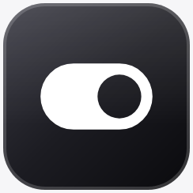
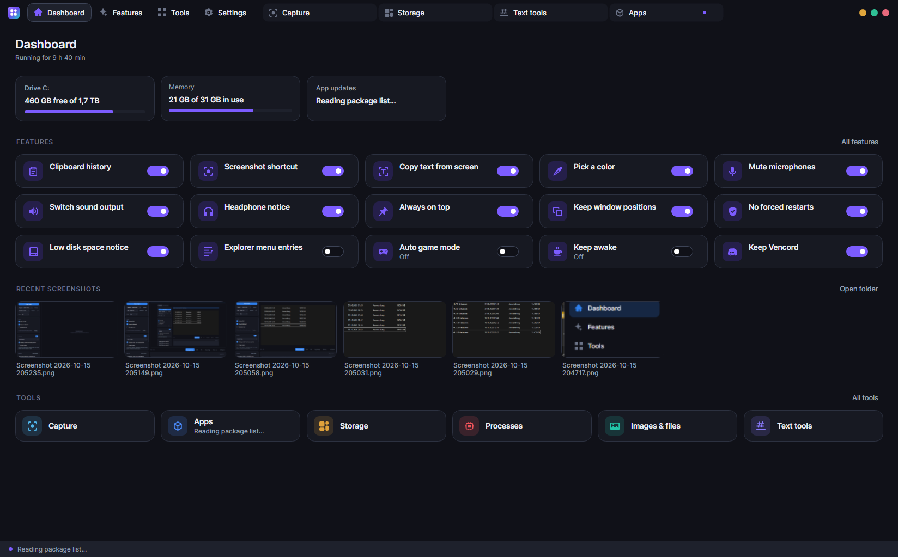
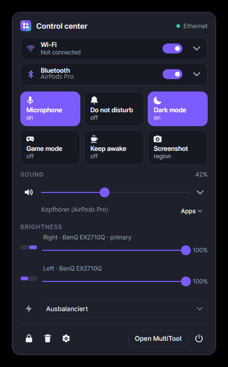
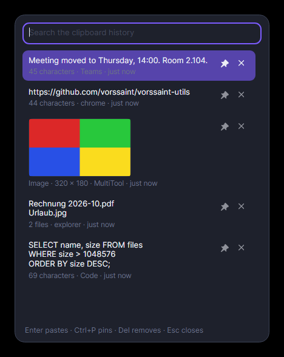
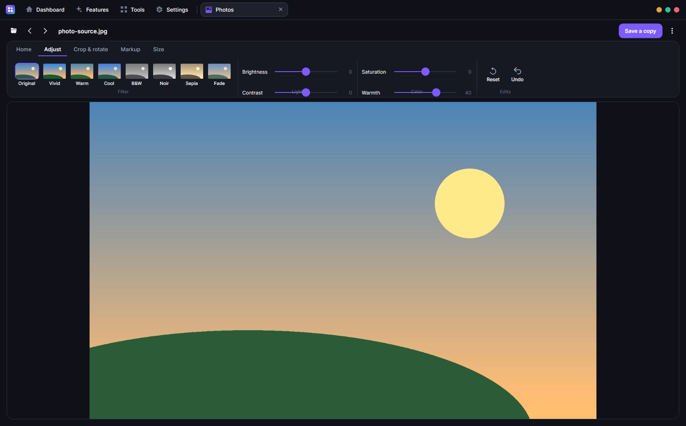
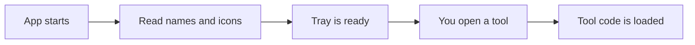

<div align="center">



# WinTo

**A tray app for Windows that fixes small things that annoy me, plus some tools I kept needing.**


[](https://github.com/businessbaum/WinTo/releases/latest)



<table>
<tr>
<td align="center"><br><sub>Control center in the tray</sub></td>
<td align="center"><br><sub>Clipboard history</sub></td>
</tr>
<tr>
<td colspan="2" align="center"><br><sub>The Photos tool</sub></td>
</tr>
</table>

</div>

## Download

You can download the installer from the [latest release](https://github.com/businessbaum/WinTo/releases/latest). It works on Windows 10 and 11 (64-bit) and installs .NET 10 if it is missing. The installer is not signed, so Windows may show a warning the first time. Click "More info" and then "Run anyway".

## What is this?

On the Mac there are many small helper apps, for example a clipboard history or a color picker. I wanted the same on Windows, but in one app instead of ten. WinTo sits in the tray and has two parts:

- Features run in the background. You turn them on or off on the Features page.
- Tools are bigger and have their own window. They only load when you open them.

The project was called MultiTool at first. I renamed it to WinTo in version 0.13.0, which is why the code still says MultiTool.

## Features

| Feature | What it does |
|---|---|
| Clipboard history | Win+V shows everything you copied, including images and files. You can search and pin entries. |
| Screenshots | Win+Shift+S opens the WinTo screenshot tool instead of the Snipping Tool. |
| Copy text from screen | Draw a box around any text, even in a picture, and it is copied. |
| Color picker | Click any pixel to copy its color code. |
| Control center | Click the tray icon for Wi-Fi, Bluetooth, volume for each app, screen brightness and what is playing. |
| Shortcuts | Mute all microphones, switch the sound output or keep a window on top. |
| Window positions | Windows go back to their place after sleep or after you plug a monitor back in. |
| Clean up Windows | 11 switches, for example no web results in Start or no Copilot button. You can turn each one back off. |
| Small helpers | Headphone notice, low disk warning, game mode, keep awake and no forced restarts. |

## Tools

| Tool | What you can do |
|---|---|
| Capture | Take screenshots, draw on them, read text from them and record your screen. |
| Photos | View and edit pictures, including HEIC, AVIF and RAW files. |
| Video | Play, cut and convert videos, or shrink them to a file size. |
| Apps | Install, update and uninstall programs. |
| Storage | See what fills your drive, find duplicates and clean up temp files. |
| Processes | End programs that Task Manager can't close, and see why. |
| More | Image converter, metadata remover, text tools, RGB lighting, a soundboard and a YouTube downloader. |

## How it works

I wanted the app to start fast and use almost no memory in the tray. So every tool is a plugin, and no plugin code is loaded when the app starts. At startup the app only reads a small file for each tool with its name and icon. The real code is loaded the first time you open that tool, and it is released again when you close it.



There is a self-test that opens every tool once and fails if tool code was loaded too early. In the tray the app uses about 10 MB of memory.

## Things I learned

- Windows has no official way for apps to turn on Do Not Disturb, so WinTo only shows it and opens the settings.
- Apps can't change your default apps on their own. Windows protects that choice, so WinTo opens the right settings page and you do the last click.
- A slider once set my real monitors to 0% brightness while I was only taking a test screenshot. Now the hardware is only changed after you touch a slider yourself.
- Keyboard shortcuts that work in every app need their own thread. Otherwise Windows removes them when the app is busy.

You can find many more of these in [docs/lessons-learned.md](docs/lessons-learned.md).

## Build it yourself

You need the .NET 10 SDK. For the installer you also need Inno Setup 6.

```powershell
.\tools\build.ps1 -Run
.\tools\publish.ps1
```

The first command builds and starts the app. The second one builds the installer.

## License

MIT, see [LICENSE](LICENSE). The libraries it uses keep their own licenses.
